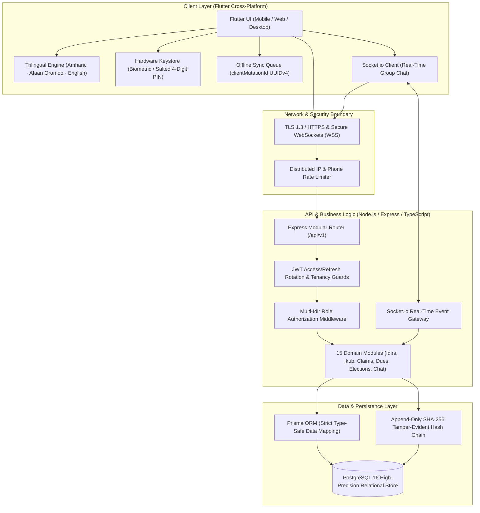

# Idir Connect (እድር ኮኔክት) — Indigenous Socio-Financial Operating System

A mission-critical, enterprise-grade digital platform designed to preserve, modernize, and scale Ethiopian community mutual-aid associations (**Idir** / እድር) and rotating savings/credit groups (**Ikub** / ዕቁብ). Built with offline-first synchronization, indigenous governance bylaw algorithms, cryptographic SHA-256 audit chaining, real-time WebSocket communication, and secret-ballot democratic elections.

[](https://flutter.dev)
[](https://dart.dev)
[](https://www.typescriptlang.org)
[](https://nodejs.org)
[](https://expressjs.com)
[](https://www.postgresql.org)
[](https://www.prisma.io)
[](https://socket.io)
[](https://opensource.org/licenses/ISC)

---

## 📑 Table of Contents

1. [Executive Overview & System Architecture](#-executive-overview--system-architecture)
2. [What Makes This Project Special](#-what-makes-this-project-special-unique-innovations)
3. [User Roles & Access Control Matrix (RBAC)](#-user-roles--access-control-matrix-rbac)
4. [Complete Feature Catalog](#-complete-feature-catalog)
5. [Database Architecture & Entity Relationships](#-database-architecture--entity-relationships)
6. [Repository & Directory Structure](#-repository--directory-structure)
7. [Getting Started & Local Installation](#-getting-started--local-installation)
8. [Automated Testing & Verification](#-automated-testing--verification)
9. [Project Documentation & Threat Model](#-project-documentation--threat-model)
10. [Authors & Project Contributors](#-authors--project-contributors)

---

## 🏛️ Executive Overview & System Architecture

An **Idir (እድር)** is a foundational Ethiopian socio-financial institution providing communal bereavement support, emergency micro-insurance, and funeral financing. An **Ikub (ዕቁብ)** is a traditional rotating savings and credit association (ROSCA) that provides crowd-funded capital liquidity.

Historically, both institutions have operated entirely on paper ledgers, informal verbal agreements, and cash boxes. While resilient for centuries, this manual operation is vulnerable to physical ledger loss, bookkeeping fraud, disputed payouts, lack of transparency for migrant members, and leadership succession deadlocks.

**Idir Connect** transitions this indigenous heritage into a high-reliability, cloud-native architecture. It combines strict mathematical solvency constraints, zero-knowledge secret balloting, cryptographic tamper-evident ledgers, real-time messaging, and multi-tenant organizational switching into a unified multi-platform application.



---

## 🌟 What Makes This Project Special (Unique Innovations)

### 1. Algorithmic Enforcement of Indigenous Bylaws

Idir Connect does not simply digitize paperwork; it programmatically codifies ancestral community bylaws into code-level constraints:

- **The Four-Eyes Principle (Two-Officer Dual Approval)**: Emergency claims, bereavement payouts, and high-value operating expenses strictly require concurring approvals from both the **Chairperson (ሰብሳቢ)** and the **Treasurer (ገንዘብ ያዥ)** before any money can be disbursed.
- **Strict Self-Approval Ban**: Officers or committee members filing personal or family bereavement claims are strictly barred by backend validation from reviewing, voting on, or disbursing their own claims.
- **Rule 3 Solvency Equation**: Real-time mathematical verification guarantees that the communal reserve fund never falls into insolvency:
  $$\text{Closing Reserve} = \text{Opening Balance} + \sum \text{Dues} - \sum \text{Disbursements} - \sum \text{Operating Expenses}$$
- **Strict Financial Segregation**: Communal mutual-aid funds and Ikub rotating savings pools are partitioned at both logical and database schema levels. Co-mingling of mutual aid and ROSCA money is physically impossible.

### 2. Forensic Cryptographic SHA-256 Audit Chain

To eliminate bookkeeping disputes and rogue ledger alterations:

- Every administrative action, financial disbursement, dues collection, and role promotion is permanently linked in an append-only cryptographic hash chain:
  $$\text{Block}_N.\text{hash} = \text{SHA256}(\text{Block}_{N-1}.\text{hash} + \text{actorId} + \text{action} + \text{entityId} + \text{safeMetadata} + \text{timestamp})$$
- An independent automated forensic engine enables the **Auditor (ኦዲተር)** to verify chain integrity on demand and immediately flags any retroactive database tampering.

### 3. Next-Generation Ikub (Rotating Savings / ROSCA) Engine

A modern digital transformation of traditional Ethiopian rotating savings pools:

- **Singleton Active Cycle Enforcement**: Guarantees only one active rotating cycle exists per Idir group to prevent participant overextension.
- **1-Click Member Enrollment & Officer Approval**: Active Idir members can join the pool with one click, backed by strict capacity gating:
  $$\text{Capacity} = \text{Total Rounds} \times \text{Winners Per Round}$$
- **Cryptographically Randomized Digital Lottery**: Draws use Node.js CSPRNG (`crypto.randomInt` and `crypto.randomBytes`) with verifiable draw seeds.
- **Audited Redraw Protection**: Once a round winner is drawn and awaiting payout, re-rolling is blocked by default (`409 Conflict`). Redraws can only occur if the officer explicitly provides an audited justification (`isRedraw: true`, `redrawReason` $\ge 5$ characters), which permanently logs an immutable `REDRAW_IKUB_LOTTERY` event.
- **Multi-Winner Equal-Split Payouts**: Backend strictly enforces equal payout shares for multi-winner rounds ($1/N$ of total pot per winner) and prevents aggregate over-payouts.
- **Atomic Compare-and-Set (CAS) Concurrency**: State transitions (`hasWonPayout: false -> true`) execute inside interactive database transactions, eliminating race conditions and double-payout vulnerabilities.

### 4. Democratic Governance, Secret Ballots & No-Confidence Motions

A full-lifecycle democratic apparatus built into the community fabric:

- **Complete Election Lifecycle**: Nominations, candidate campaign statements, voter qualification verification, secret balloting booth, automated vote tallying, and voter verification receipts (`VoteReceipt`).
- **48-Hour Dispute Window**: A constitutional pause period where disputes are submitted to an independent committee before automated officer role handover.
- **Constitutional Votes of No-Confidence**: Community members can initiate no-confidence motions against non-performing leadership, requiring a constitutional **66.67% (two-thirds) supermajority** threshold to impeach or reassign an officer.

### 5. Real-Time Secure Community Group Chat

- Integrated **Socket.io / WebSocket** communication gateway scoped strictly to Idir active memberships.
- Role-badged chat bubbles (Chairperson, Treasurer, Secretary, Auditor, Member) to distinguish official announcements from casual discussion.
- Read receipts, real-time message persistence in PostgreSQL, announcement broadcasting tabs, and graceful offline fallback.

### 6. Offline-First Resilience for Rural Networks

- Dues collectors operating in areas with poor or intermittent connectivity can record cash dues offline.
- Transactions are generated with client-side UUIDv4 mutation keys (`clientMutationId`).
- Upon reconnection, the backend's idempotent transaction processor guarantees zero double-charging or ledger corruption.

### 7. Trilingual Ethiopic Localization & Cultural Typography

- Native localization across three primary languages: **Amharic (አማርኛ)**, **Afaan Oromoo**, and **English**.
- Custom Ethiopic font integration using Google’s `Noto Sans Ethiopic` for authentic, readable rendering of Ge'ez script across iOS, Android, Web, and Desktop.

### 8. Multi-Idir Tenancy & Hardware Keystore Security

- A single user identity can hold memberships across multiple independent Idirs (e.g., neighborhood Idir, workplace Idir, hometown diaspora Idir) with distinct roles in each.
- Dynamic workspace switching updates the application context, permissions, and theme instantaneously.
- Sensitive authentication tokens and PINs are stored in hardware-backed security enclaves (`flutter_secure_storage` / Keychain / KeyStore) with 2-minute auto-inactivity lockouts and 5-attempt brute-force protection.

---

## 👥 User Roles & Access Control Matrix (RBAC)

Idir Connect enforces a strict Role-Based Access Control (RBAC) matrix to guarantee separation of duties:

| Role                 | Title (Amharic)  | Core Responsibilities & Authority                                                                                                                                                          |
| :------------------- | :--------------- | :----------------------------------------------------------------------------------------------------------------------------------------------------------------------------------------- |
| **`PLATFORM_ADMIN`** | የስርዓት የበላይ ተቆጣጣሪ | System-wide administrator. Manages server health, platform metrics, and cross-Idir tenancy resolution. Has no access to private mutual-aid claim details.                                  |
| **`CHAIRPERSON`**    | ሰብሳቢ             | Executive association leader. Oversees Idir bylaws, approves assistance claims (First Approver), approves operating expenses, calls meetings, and conducts Ikub lottery draws.             |
| **`TREASURER`**      | ገንዘብ ያዥ          | Chief financial officer. Fiduciary custody of cash and bank balances. Second Approver for all claims and expenses, records dues contributions, and executes payouts.                       |
| **`SECRETARY`**      | ፀሐፊ              | Chief administrative officer. Manages general assembly and committee meetings, agendas, attendance rosters, member invitations, and Ikub join requests.                                    |
| **`AUDITOR`**        | ኦዲተር             | Independent governance inspector. Read-only forensic access to all financial ledgers, bank transactions, and the SHA-256 cryptographic audit chain. Triggers integrity verification scans. |
| **`COMMITTEE`**      | የሥራ አስፈፃሚ ኮሚቴ    | Executive council. Reviews claim investigations, handles election dispute resolution hearings, and establishes quorum for association decisions.                                           |
| **`MEMBER`**         | አባል              | Community beneficiary and contributor. Submits assistance claims, pays dues, votes in secret-ballot elections, files nominations, participates in Ikub, and uses real-time chat.           |

### Detailed Access Permission Matrix

| Capability / Action                          |   Chairperson   |    Treasurer    |   Secretary   |    Auditor    |   Committee   |    Member     | Platform Admin |
| :------------------------------------------- | :-------------: | :-------------: | :-----------: | :-----------: | :-----------: | :-----------: | :------------: |
| **Create & Configure Idir Bylaws**           |       ✅        |       ❌        |      ❌       |      ❌       |      ❌       |      ❌       |       ✅       |
| **Manage Member Roster (Roles/Status)**      |       ✅        |       ✅        |      ✅       |      ❌       |      ❌       |      ❌       |       ✅       |
| **Record Dues Contributions**                |       ❌        |       ✅        |      ❌       |      ❌       |      ❌       |      ❌       |       ❌       |
| **Issue Downloadable PDF Receipts**          |       ✅        |       ✅        |      ✅       |      ✅       |      ✅       |   ✅ (Own)    |       ❌       |
| **Submit Assistance / Bereavement Claim**    |       ✅        |       ✅        |      ✅       |      ❌       |      ✅       |      ✅       |       ❌       |
| **Review & Approve Assistance Claim**        | ✅ (Approver 1) | ✅ (Approver 2) |      ❌       |      ❌       |   👁️ Review   |      ❌       |       ❌       |
| **Self-Approve Personal Claim**              |  🚫 **BANNED**  |  🚫 **BANNED**  | 🚫 **BANNED** | 🚫 **BANNED** | 🚫 **BANNED** | 🚫 **BANNED** | 🚫 **BANNED**  |
| **Disburse Assistance Payout**               |       ❌        |       ✅        |      ❌       |      ❌       |      ❌       |      ❌       |       ❌       |
| **Log Operating Expense**                    |       ❌        |       ✅        |      ❌       |      ❌       |      ❌       |      ❌       |       ❌       |
| **Approve Operating Expense**                |       ✅        |       ❌        |      ❌       |      ❌       |      ❌       |      ❌       |       ❌       |
| **Inspect General Financial Ledger**         |       ✅        |       ✅        |      ✅       |      ✅       |      ✅       |      ❌       |       ❌       |
| **Verify SHA-256 Cryptographic Audit Chain** |       ✅        |       ❌        |      ❌       |      ✅       |      ❌       |      ❌       |       ✅       |
| **Setup & Call Leadership Election**         |       ✅        |       ❌        |      ✅       |      ❌       |      ❌       |      ❌       |       ❌       |
| **Cast Anonymous Secret Ballot Vote**        |       ✅        |       ✅        |      ✅       |      ✅       |      ✅       |      ✅       |       ❌       |
| **Initiate Vote of No-Confidence**           |       ❌        |       ✅        |      ✅       |      ✅       |      ✅       |      ✅       |       ❌       |
| **Create & Manage Ikub Group Cycle**         |       ✅        |       ✅        |      ❌       |      ❌       |      ❌       |      ❌       |       ❌       |
| **Enroll in Ikub (1-Click Self-Join)**       |       ✅        |       ✅        |      ✅       |      ✅       |      ✅       |      ✅       |       ❌       |
| **Conduct Ikub Lottery Draw**                |       ✅        |       ✅        |      ❌       |      ❌       |      ❌       |      ❌       |       ❌       |
| **Conduct Audited Ikub Redraw**              |  ✅ (Audited)   |  ✅ (Audited)   |      ❌       |      ❌       |      ❌       |      ❌       |       ❌       |
| **Disburse Ikub Round Payout**               |       ❌        |       ✅        |      ❌       |      ❌       |      ❌       |      ❌       |       ❌       |
| **Send Real-Time Group Chat Messages**       |   ✅ (Badged)   |   ✅ (Badged)   |  ✅ (Badged)  |  ✅ (Badged)  |  ✅ (Badged)  |      ✅       |       ❌       |
| **Broadcast Official Announcements**         |       ✅        |       ✅        |      ✅       |      ❌       |      ❌       |      ❌       |       ❌       |
| **Hard-Delete Financial Records**            |  🚫 **BANNED**  |  🚫 **BANNED**  | 🚫 **BANNED** | 🚫 **BANNED** | 🚫 **BANNED** | 🚫 **BANNED** | 🚫 **BANNED**  |

---

## 📦 Complete Feature Catalog

### 1. Identity, Authentication & Security

- **Dual Credential Entry**: Login via Ethiopian mobile phone format (`+2519...`, `+2517...`) or verified email address.
- **Native Email OTP Authentication**: 6-digit cryptographic verification code sent via SMTP with 10-minute expiry.
- **JWT Rotation & Refresh Token Families**: Short-lived access tokens (15 minutes) paired with rotating refresh tokens (7 days). Token family reuse detection automatically invalidates compromised sessions.
- **Biometric & 4-Digit Hardware PIN**: Encrypted PIN storage with automatic 2-minute inactivity screen blackout and 5-attempt brute-force lockouts.
- **Cross-Idir Tenancy Isolation**: Every database query is scoped by `idirId`. Members cannot access data or messages from associations they do not belong to.

### 2. Multi-Idir Workspace & Organization Management

- **Seamless Association Switching**: One user account can switch between multiple Idirs in a single tap without re-authenticating.
- **Customizable Indigenous Bylaws**: Define regular dues amounts, dues frequency (Weekly, Biweekly, Monthly, Quarterly, Annually), late payment grace periods, and maximum yearly assistance caps.
- **Member Directory & Family Roster**: Register primary members and family dependents with designated emergency contact information.
- **Role Elevation & Term Tracking**: Manage transitions between Member, Committee, Auditor, Secretary, Treasurer, and Chairperson.

### 3. Financial Dues & Offline Contributions

- **Multi-Channel Payment Recording**: Supports CASH, CBE Birr, Telebirr, and Bank Transfer with transaction reference numbers.
- **Offline Contribution Submission**: Generates a local `clientMutationId` to queue payments when offline and guarantees exactly-once processing upon reconnection.
- **Official In-App PDF Receipts**: Generates instant printable PDF receipts featuring unique serial numbers (`REC-YYMMDD-XXXX`), association branding, and payment method details.
- **Audited Financial Reversals**: Zero hard deletions. Inadvertent entries are corrected via auditable reversals requiring mandatory documented justifications.

### 4. Emergency & Bereavement Claims (Mutual-Aid)

- **Claim Categorization**: Standardized filing for Funeral, Medical Illness, Accident, Property Loss, or Other emergencies.
- **Document Evidence Uploads**: Upload death certificates, medical records, or police reports directly from mobile camera or gallery.
- **Four-Eyes Approval Workflow**: Live status tracker showing independent approval steps for both the Chairperson and Treasurer.
- **Confidential Illness Case Protection**: Medical claims can be marked confidential, restricting visibility strictly to authorized reviewing officers.
- **Automated Solvency Validation**: Prevents approving claims if the disbursement amount exceeds current association reserve balances.

### 5. Operating Expenses & Budget Management

- **Expense Categorization**: Equipment, Venue Hire, Funeral Supplies, Tent Rental, Utilities, and Administrative expenditures.
- **Digital Receipt Capture**: Attach physical receipt photographs to expense claims.
- **Dual Officer Authorization**: Prevents unilateral spending by requiring independent officer verification before ledger debiting.

### 6. Democratic Elections & Governance

- **Nomination Period**: Open candidate nominations for all leadership roles with eligibility validation.
- **Public Campaign Statements**: Candidates submit vision statements for general assembly review.
- **Secret Balloting Booth**: Cryptographically blinded voting prevents tracking which member voted for which candidate.
- **Voter Verification Receipts (`VoteReceipt`)**: Voters receive a cryptographic hash receipt confirming their ballot was counted in the final tally without exposing their choice.
- **Dispute Resolution & Automatic Role Handover**: 48-hour dispute window allows committee review before role terms automatically transition in the database.
- **Votes of No-Confidence**: Community-initiated impeachment petitions requiring a 66.67% supermajority to unseat officers.

### 7. Next-Generation Ikub (Rotating Savings / ROSCA)

- **Cycle Configuration**: Set contribution amounts, frequency, total rounds, draw mode (Automated Digital Lottery vs. Physical Recorded), and winners per round.
- **Instant 1-Click Enrollment**: Immediate self-service entry for active Idir members with automated capacity protection.
- **Audited Redraw Protection**: Prevents arbitrary re-rolling of drawn winners unless an explicit audited reason is entered for community records.
- **Multi-Winner Equal-Split Payouts**: Automatically calculates and enforces equal pot distribution ($1/N$) for multi-winner rounds.
- **Atomic CAS Concurrency**: Interactive database transaction state-locks eliminate concurrent double-payout vulnerabilities.

### 8. Real-Time Community Group Chat

- **WebSocket Group Channels**: Dedicated real-time communication room for each Idir.
- **Officer Role Badging**: Chat bubbles clearly display official titles (ሰብሳቢ, ገንዘብ ያዥ, etc.) to prevent impersonation.
- **Announcement Tab**: Dedicated broadcast tab for urgent community notifications, meeting notices, and bereavement alerts.
- **Message Read Tracking & Persistence**: Real-time delivery and read indicators backed by PostgreSQL persistence.

### 9. Meetings & Assembly Management

- **Meeting Scheduling**: Schedule General Assembly, Executive Committee, or Emergency gatherings.
- **Digital Roll-Call**: Track attendance as Present, Absent, Excused, or Late.
- **Meeting Minutes & Decisions**: Document resolutions and community votes directly in the meeting record.

### 10. Financial Reporting & Forensic Audit

- **Rule 3 Solvency Statement**: Automated balance sheet proving reserve adequacy.
- **Auditor Verification Console**: Instant cryptographic audit-chain integrity scanner that detects retroactive database tampering.
- **Export Formats**: Download comprehensive financial balance sheets and member contribution statements in PDF and CSV.

---

## 🗄️ Database Architecture & Entity Relationships

The PostgreSQL database (managed via Prisma ORM) is structured around strict relational integrity and financial isolation:

```mermaid
erDiagram
    User ||--o{ RefreshToken : authenticates
    User ||--o{ Membership : holds
    User ||--o{ Notification : receives
    User ||--o{ AuditLog : performs
    User ||--o{ ChatMessage : posts

    Idir ||--|| IdirSettings : configures
    Idir ||--o{ Membership : contains
    Idir ||--o{ ContributionType : defines
    Idir ||--o{ Contribution : collects
    Idir ||--o{ Expense : incurs
    Idir ||--o{ AssistanceCase : manages
    Idir ||--o{ IkubGroup : hosts
    Idir ||--o{ Meeting : schedules
    Idir ||--o{ Announcement : broadcasts
    Idir ||--o{ Election : conducts
    Idir ||--o{ ChatMessage : isolates

    Membership ||--o{ Contribution : pays
    Membership ||--o{ AssistanceCase : files
    Membership ||--o{ IkubParticipant : enrolls
    Membership ||--o{ IkubJoinRequest : requests
    Membership ||--o{ MeetingAttendance : attends
    Membership ||--o{ VoteReceipt : receives
    Membership ||--o{ Ballot : casts

    AssistanceCase ||--o{ AssistanceDisbursement : fulfills

    IkubGroup ||--o{ IkubParticipant : contains
    IkubGroup ||--o{ IkubRound : divides_into
    IkubGroup ||--o{ IkubJoinRequest : receives
    IkubRound ||--o{ IkubContribution : collects
    IkubRound ||--o{ IkubPayout : disburses
    IkubParticipant ||--o{ IkubContribution : deposits
    IkubParticipant ||--o{ IkubPayout : receives

    Election ||--o{ Candidate : fields
    Election ||--o{ Ballot : collects
    Election ||--o{ VoteReceipt : issues
    Election ||--o{ ElectionDispute : receives
```



---

## 📁 Repository & Directory Structure

```
Idir/
├── documentation.md                 # Complete Graduation Project Technical Report & Defense Guide
├── THREAT_MODEL.md                  # STRIDE & OWASP Security Architecture Specification
├── README.md                        # Master Project Documentation & System Design Manual
│
├── backend/                         # Modular Monolith REST API & WebSocket Server
│   ├── prisma/
│   │   ├── schema.prisma            # 21-entity relational database schema
│   │   ├── seed.ts                  # Realistic Ethiopian community seed data
│   │   └── migrations/              # Versioned PostgreSQL migration history
│   ├── src/
│   │   ├── app.ts                   # Express server routing, middleware & Socket.io mount
│   │   ├── server.ts                # Server bootstrap, WebSocket setup & graceful shutdown
│   │   ├── config/                  # Database, Redis, and environment configurations
│   │   ├── middleware/              # Auth, RBAC, Active Idir assertion, Rate limiter, Validation
│   │   ├── modules/                 # 15 Isolated Domain Modules:
│   │   │   ├── assistance/          # Claims, bereavement approvals & Four-Eyes disbursements
│   │   │   ├── audit/               # SHA-256 tamper-evident audit chain verification
│   │   │   ├── auth/                # Phone/Email auth, JWT rotation, OTP verification
│   │   │   ├── chat/                # Socket.io real-time chat, message persistence & history
│   │   │   ├── contributions/       # Dues ledger, offline mutation deduplication & reversals
│   │   │   ├── elections/           # Nominations, secret voting, tallies & no-confidence
│   │   │   ├── expenses/            # Operating expense tracking & dual-officer approvals
│   │   │   ├── idirs/               # Association lifecycle, bylaws & multi-tenant settings
│   │   │   ├── ikub/                # ROSCA pools, CSPRNG draws, audited redraws & payouts
│   │   │   ├── invitations/         # Tokenized SMS and Email member invitation flows
│   │   │   ├── meetings/            # Assembly scheduling, attendance roll-call & minutes
│   │   │   ├── memberships/         # Role assignment, member directory & family dependents
│   │   │   ├── notifications/       # Multi-channel in-app, SMS, and email dispatchers
│   │   │   ├── reports/             # Balance sheets, Rule 3 solvency & CSV/PDF exports
│   │   │   └── users/               # Profiles, language preferences & security credentials
│   │   └── shared/                  # Errors, utilities, logging (Pino), and JWT helpers
│   ├── tests/                       # 15 Vitest automated test suites (196 passing tests)
│   ├── docker-compose.yml           # PostgreSQL 16 container definition
│   └── package.json                 # Backend dependencies, scripts & configuration
│
└── frontend/                        # Cross-Platform Client Application (Flutter 3.22 / Dart 3.3)
    ├── lib/
    │   ├── main.dart                # App entrypoint, Riverpod ProviderScope & router bootstrap
    │   ├── core/                    # Shared infrastructure:
    │   │   ├── network/             # Dio HTTP client, interceptors & error handlers
    │   │   ├── router/              # GoRouter with authenticated, role-based route guards
    │   │   ├── storage/             # Hardware keystore & FlutterSecureStorage PIN service
    │   │   ├── theme/               # Modern responsive theme (Light/Dark) & Ethiopian green palette
    │   │   └── providers/           # Active Idir, user session & connectivity state notifiers
    │   ├── features/                # 17 Feature Modules:
    │   │   ├── announcements/       # Community bulletin board & priority broadcasts
    │   │   ├── audit/               # Auditor dashboard & cryptographic verification UI
    │   │   ├── auth/                # Login, registration, Email OTP verification & PIN screen
    │   │   ├── chat/                # Real-time group chat screen, badges & message bubbles
    │   │   ├── claims/              # Bereavement claim submission, evidence & approval tracker
    │   │   ├── contributions/       # Dues collection, payment methods & PDF receipts
    │   │   ├── elections/           # Voting booth, candidate profiles & result tallies
    │   │   ├── expenses/            # Expense vouchers, receipt capture & review screens
    │   │   ├── home/                # Role-tailored dashboards & quick-action shortcuts
    │   │   ├── idirs/               # Association switcher modal, creation wizard & bylaws
    │   │   ├── ikub/                # Ikub hub, animated lottery wheel, redraw dialog & payouts
    │   │   ├── invitations/         # Invite generation, phone validation & QR links
    │   │   ├── members/             # Member directory, roles & family dependents
    │   │   ├── more/                # Settings, language picker & utility screens
    │   │   ├── notifications/       # In-app notification center & push feeds
    │   │   └── reports/             # Balance sheet viewers & PDF invoice generators
    │   └── l10n/                    # Trilingual ARB localization (Amharic, Afaan Oromoo, English)
    ├── assets/                      # Typography (Noto Sans Ethiopic), icons & graphic assets
    ├── pubspec.yaml                 # Flutter dependencies & assets mapping
    └── test/                        # 25 Flutter automated unit and widget test suites
```

---

## 🚀 Getting Started & Local Installation

To run the complete platform locally, open **two terminal windows**:

### Prerequisites

- **Node.js**: $\ge 20.x$
- **npm**: $\ge 10.x$
- **Flutter SDK**: $\ge 3.22.x$ with Dart $\ge 3.3.x$
- **Docker & Docker Compose** (or local PostgreSQL 16 instance)

---

### Step 1: Start Backend REST API & PostgreSQL (Terminal 1)

```bash
# 1. Navigate to the backend directory
cd backend

# 2. Start PostgreSQL 16 database container in Docker
docker-compose up -d postgres

# 3. Install backend dependencies
npm install

# 4. Configure environment variables (if not already present)
cp .env.example .env

# 5. Generate Prisma Client & apply database migrations
npm run prisma:generate
npm run prisma:migrate

# 6. Seed database with realistic Ethiopian community test accounts
npm run prisma:seed

# 7. Start the backend development server
npm run dev
```

- 🌐 **REST API Base URL**: `http://localhost:5000/api/v1`
- 📖 **Interactive Swagger API Documentation**: `http://localhost:5000/api/docs`
- 💓 **Health Check Endpoint**: `http://localhost:5000/health`
- 🔌 **WebSocket Gateway**: `ws://localhost:5000`

---

### Step 2: Start Frontend Application (Terminal 2)

```bash
# 1. Navigate to the frontend directory
cd frontend

# 2. Install Flutter dependencies
flutter pub get

# 3. Generate trilingual localization classes (Amharic, Afaan Oromoo, English)
flutter gen-l10n

# 4. Launch the application:
# Option A: In Google Chrome (Web):
flutter run -d chrome --web-port 8080

# Option B: Headless Web Server:
flutter run -d web-server --web-port=8080 --web-hostname=0.0.0.0

# Option C: On connected Android Device or Emulator:
flutter run
```

- 📱 **Web Application URL**: `http://localhost:8080`

---

## 🧪 Automated Testing & Verification

The platform is fortified with rigorous automated test suites across both backend and frontend:

### Backend Automated Test Suite (Vitest)

```bash
cd backend
npm test
```

- **Coverage**: 15 test suites comprising **196 passing automated tests** (100% pass rate).
- **Test Domains**: Multi-role authorization gates, cross-Idir tenancy isolation, Four-Eyes approval enforcement, self-approval prevention, Rule 3 solvency validation, secret ballot tallying, Ikub lottery draws, audited redraw constraints, and payout CAS concurrency safety.

### Backend TypeScript Strict Build Check

```bash
cd backend
npm run build
```

- Compiles the TypeScript codebase under strict mode (`tsc`) with zero errors.

### Frontend Static Analysis & Test Suite

```bash
cd frontend
# 1. Run Flutter static analyzer
flutter analyze

# 2. Run automated unit and widget test suites
flutter test
```

- **Coverage**: 25 Flutter automated test suites covering Riverpod state management, GoRouter role guards, cryptographic PIN validation, offline dues queueing, and UI rendering.

---

## 📚 Project Documentation & Threat Model

- **STRIDE Threat Model & Security Architecture**: [THREAT_MODEL.md](file:///c:/Users/HP/Desktop/Idir/THREAT_MODEL.md)
- **Graduation Project Technical Report & Defense Guide**: [documentation.md](file:///c:/Users/HP/Desktop/Idir/documentation.md)
- **Backend Architecture & Database Specifications**: [backend/README.md](file:///c:/Users/HP/Desktop/Idir/backend/README.md)
- **Three-Developer Module Division & Ownership**: [backend/MODULE_OWNERSHIP.md](file:///c:/Users/HP/Desktop/Idir/backend/MODULE_OWNERSHIP.md)
- **Deferred Features & Production Roadmap**: [backend/DEFERRED_FEATURES.md](file:///c:/Users/HP/Desktop/Idir/backend/DEFERRED_FEATURES.md)

---

## 👥 Authors & Project Contributors

Developed by the following software developers team:

- **Yeroman Diriba CTC-3457-26  Backend developer** 
- **Ebisa Mitiku   CTC-064-26   Database developer**
- **Lami Megersa   CTC-093-26   Frontend developer**

---

_Idir Connect (እድር ኮኔክት) — Preserving Ethiopian communal heritage through resilient, modern software engineering._


- **Idir-Connect Documentation:- <a href="https://docs.google.com/presentation/d/16NJ6RlEmlqe_ue8JMzOjx9ILRNClC6Uh/edit?usp=sharing&ouid=109770059071934906386&rtpof=true&sd=true">here</a>**
- **Idir-Connect Video:- <a href="[https://drive.google.com/file/d/1tlj_OHdaUGDK6JTIshnfQBpvstNBmU3X/preview?usp=sharing](https://drive.google.com/file/d/1tlj_OHdaUGDK6JTIshnfQBpvstNBmU3X/preview?usp=sharing)">here</a>**
